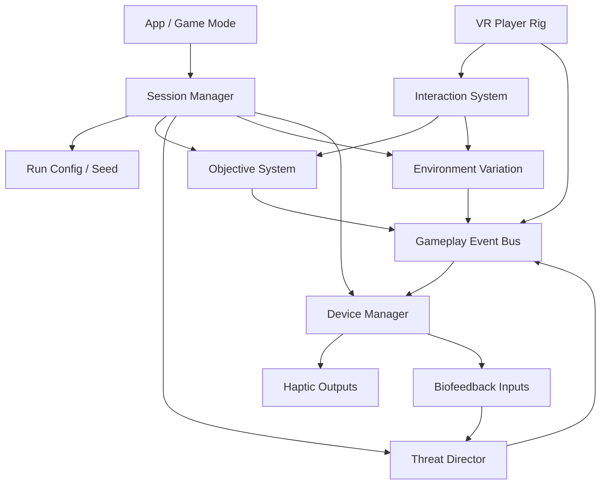

# Technical Architecture Outline

Status: Living architecture outline; Unity implementation exists and requires continued alignment

Last updated: 2026-07-22

The engine is Unity 6000.5.4f1. The current stack includes URP, Input System, XR Interaction Toolkit, OpenXR, and Unity AI Navigation. The target venue headset and physical hardware are still unknown, so gameplay must remain runnable through desktop and simulated-device adapters.

## Architecture Goals

- Keep gameplay playable without external hardware.
- Keep hardware integrations replaceable.
- Make adaptive behavior debuggable.
- Support quick prototype iteration.
- Avoid vendor SDK calls inside core gameplay logic.
- Prioritize VR comfort, reliability, and demo reset flow.

## High-Level System Breakdown



## Core Systems

### Session Manager

Responsibilities:

- Start run.
- End run.
- Restart demo cleanly.
- Track session timer.
- Own current run state.
- Coordinate success/failure transitions.

Should not:

- Contain enemy AI details.
- Contain vendor hardware API calls.

### Run Config

Responsibilities:

- Store selected run variables.
- Select objective location.
- Select hazard/route states.
- Select threat profile.
- Expose debug readout.

Early implementation:

- Manual or random selection from authored options.

Later implementation:

- Seeded runs if deterministic replay is useful.

### VR Player Rig

Responsibilities:

- Headset and controller tracking.
- Locomotion.
- Comfort settings.
- Player body/proximity data.
- Interaction origin points.

Comfort requirements:

- Avoid forced camera motion where possible.
- Support snap turn or comfort settings.
- Keep player height/calibration clear.
- Avoid required frantic movement.

### Interaction System

Responsibilities:

- Object detection.
- Grab/activate/scan actions.
- Interaction prompts or diegetic feedback.
- Signal core interaction.

Prototype recommendation:

- Start with one reliable interaction style rather than multiple competing methods.

### Objective System

Responsibilities:

- Track signal core objective.
- Announce objective states through events.
- Validate extraction success.
- Provide objective feedback.

Example states:

- NotStarted
- LocateCore
- CoreCollected
- ReturnToExtraction
- Extracted
- Failed

### Threat Director

Responsibilities:

- Convert player/run signals into threat pressure.
- Choose threat state.
- Trigger warnings and peaks.
- Keep intensity within comfort/safety limits.

Inputs:

- Time in run.
- Objective progress.
- Player noise or interaction events.
- Player proximity to threat zones.
- Optional biofeedback signal.

Outputs:

- Threat state changes.
- Audio/lighting cues.
- Haptic cue requests.
- Entity behavior commands.

Prototype threat model:

- Pressure score from 0 to 100.
- Thresholds trigger investigation and hunt cues.
- Cooldown prevents constant pressure.

### Hardware Device Manager

Responsibilities:

- Detect enabled devices.
- Provide simulated devices.
- Handle unavailable/failing devices.
- Normalize data before gameplay uses it.
- Route haptic requests to available outputs.

Rule:

- Core gameplay talks to abstract interfaces, not device SDKs.

Example interfaces:

```text
IHapticOutput
- IsAvailable
- PlayCue(cueId, intensity, duration)
- StopCue(cueId)
- StopAll()

IBioSignalInput
- IsAvailable
- GetHeartRate()
- GetStressEstimate()
- GetSignalQuality()

IDeviceHealth
- Status
- LastError
- Reconnect()
```

### Entity AI Technology Boundary

Current MLP behavior remains deterministic and testable:

- valid perception,
- run-only behavioral memory,
- suspicion and adaptation thresholds,
- strategy bias and authored state selection,
- pacing-director limits,
- `IThreatNavigator` movement,
- operator telemetry and deterministic fallback.

A future learned model may be researched only behind a narrow strategy-policy interface. Its output must be validated and bounded by deterministic code. It cannot directly control movement, detection truth, capture, win/loss, camera, haptic safety, raw biofeedback, or session lifecycle.

Do not reinstall Unity AI Inference or add another ML runtime without an approved R&D task satisfying `22_ai_technology_strategy.md`.

### Gameplay Event Bus

Responsibilities:

- Broadcast important gameplay events without tight coupling.
- Allow haptics/audio/threat/objectives to react independently.

Example events:

- RunStarted
- ObjectiveRevealed
- CorePickedUp
- CoreExtracted
- PlayerMadeNoise
- ThreatStateChanged
- HapticCueRequested
- DeviceDisconnected
- RunEnded

## Hardware and Biofeedback Principles

- Raw sensor data should never directly decide win/loss.
- Heart rate should be smoothed and quality-checked.
- Biofeedback should influence intensity or flavor before it affects core difficulty.
- Every hardware feature needs Disabled, Simulated, and Live modes.
- Device failure should degrade gracefully.
- Haptic intensity needs caps, cooldowns, and calibration.

Future heart-rate stealth uses an observable mediated path:

```text
IBioSignalInput (Disabled / Simulated / Live)
    -> signal quality and personal baseline calibration
    -> bounded normalized stress value
    -> avatar breathing/noise presentation
    -> ordinary gameplay stimulus
    -> entity perception
```

Requirements:

- Provide a designer-controlled normalized slider before real hardware integration.
- Allow a deterministic simulator to spike after configured close encounters and decay during recovery.
- Log raw-adapter quality, normalized value, breathing output, stimulus, and entity response separately.
- Cap contribution and preserve pacing recovery so the loop cannot become self-reinforcing and unavoidable.
- Keep a gameplay-equivalent non-sensor path.

## Debugging Tools To Build Early

- Current run state.
- Current objective state.
- Current threat state.
- Threat pressure score.
- Selected run variables.
- Hardware mode: Disabled, Simulated, Live.
- Last haptic cue fired.
- Comfort flags or forced locomotion warnings.
- Player stealth state: Concealed, Noticeable, or Exposed.
- Visibility and noise contributions.
- Recent noise events.
- Biofeedback mode, signal quality, calibrated baseline, normalized slider/simulator value, and avatar breathing output.
- Entity perception evidence produced by breathing or other player stimuli.

## Current Platform Decisions

- Engine: Unity 6000.5.4f1.
- Rendering: Universal Render Pipeline.
- Input: Unity Input System with desktop and XR paths.
- XR: XR Interaction Toolkit and OpenXR; exact target headset/runtime pending.
- Threat movement: Unity AI Navigation behind `IThreatNavigator`, with an authored waypoint fallback.
- Hardware: vendor-neutral gameplay interfaces with Disabled, Simulated, and Live modes.

## Next Architecture Work

- Audit the implemented Unity systems against this outline and record any intentional deviations.
- Define capture and recovery as explicit run-state transitions rather than ad hoc enemy-side effects.
- Keep rod rejection consequences event-driven so audio, threat pressure, UI, and future haptics can react independently.
- Prepare a hardware inventory and adapter checklist once office/device access returns.
- Do not let target-headset uncertainty block desktop design validation, but do not claim desktop tests as VR comfort evidence.
